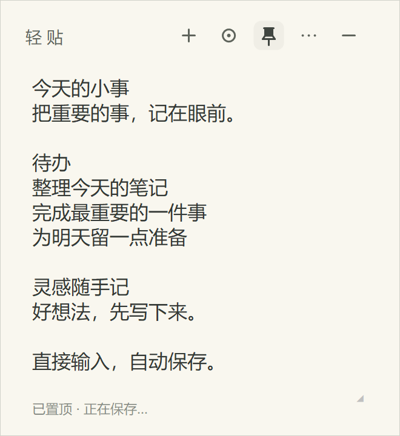

<p align="center"></p>

# 轻贴 QingTie

把重要的事，记在眼前。

轻贴是一款 Windows 桌面便签工具。直接输入、自动保存，用颜色区分不同的事；暂时不用时收成一颗悬浮球，需要时再展开。无需账号，便签保存在本机。

**当前版本：1.0.0 · 便携版 · 2026-10-29**

[下载 Windows 版](https://github.com/cuimingr/QingTie/releases/latest) · [更新记录](CHANGELOG.md) · [反馈问题](https://github.com/cuimingr/QingTie/issues)

## 开始使用

1. 将发布压缩包完整解压到一个普通文件夹。
2. 双击 `轻贴.exe`，直接开始输入。
3. 程序会在输入停止约 0.45 秒后保存，也可以按 `Ctrl+S` 手动保存。

已有旧版时，先从系统托盘右键选择「退出」，再运行新版。同一 Windows 用户下，新版会继续读取原来的便签。

适用环境：Windows 10 / 11 桌面系统，.NET Framework 4.8 或更高的 4.x 版本。不需要安装 Node.js、Python 或其他开发工具。程序为 AnyCPU 托管应用，本次发布在 Windows 64 位环境验证。



## 能做什么

- 多张便签，内容和窗口状态独立保存。
- 四个色系、共 32 色：马卡龙、奶油、雾感、深色。
- 可选置顶，以及 50%～100% 的不透明度。
- 自由移动、四边与四角缩放，最小尺寸为 180×140，随显示缩放调整。
- 鼠标滚轮平滑滚动，细滚动条按像素拖动。
- 悬浮球临时收起，展开时恢复窗口及阅读状态。
- 本地自动保存、文本导出、系统托盘操作。

## 常用操作

| 操作 | 使用方式 |
| --- | --- |
| 新建便签 | 顶栏「＋」或 `Ctrl+N` |
| 换一种颜色 | 顶栏圆环按钮，在当前色系的 8 色中循环 |
| 切换色系 | 「⋯ → 切换色系」 |
| 置顶 / 取消置顶 | 顶栏图钉；置顶时淡底色图钉加深，底部显示「已置顶」 |
| 调整透明度 | 「⋯ → 不透明度」；数值越小越透明 |
| 移动 / 缩放 | 拖动顶栏 / 拖动任意边缘或四角 |
| 临时收起 | 顶栏「−」，变成悬浮球 |
| 展开便签 | 单击悬浮球，或拖入「展开」区域松手 |
| 关闭这张便签 | 「⋯ → 关闭这张便签」，或拖动悬浮球到「关闭」区域 |
| 导出文本 | 「⋯ → 导出为文本…」 |
| 保存 | 自动保存，或 `Ctrl+S` |
| 收起菜单 | 再点一次「⋯」、点击空白处，或按 `Esc` |
| 找回关闭的便签 | 托盘右键「显示全部」，或双击托盘图标 |
| 退出程序 | 托盘右键「退出」 |

## 悬浮球怎么用

按住悬浮球并移动后，球旁会出现「展开」「关闭」两个按钮。操作区出现后保持原位，方便短距离拖入；在其他位置松手，只移动球。松手后操作区消失，下次拖动时会在球的新位置旁显示。

展开时会恢复收起前的窗口位置、大小、颜色、透明度、置顶状态、阅读位置和文字选区。球靠近屏幕左右边缘松手时可吸附。

**临时收起、关闭和删除是三种不同操作：**

| 状态 | 内容是否保留 | 重新启动时 |
| --- | --- | --- |
| 收为悬浮球 | 保留 | 恢复正常便签窗口 |
| 关闭便签 | 保留，可从托盘找回 | 保持关闭 |
| 删除便签 | 从当前便签列表移除，操作前会确认 | 不恢复该便签 |

## 数据与备份

便签数据存放在当前 Windows 用户的以下目录，与程序所在文件夹分开：

```text
%LOCALAPPDATA%\QingTie\
├─ notes.json       当前便签与设置
└─ notes.json.bak   上一次保存的备份（首次保存后可能尚未生成）
```

便签以明文 JSON 保存，不加密。程序不包含网络请求，不上传便签内容；本版没有云同步。

备份或换电脑：先从托盘退出轻贴，再复制整个 `QingTie` 数据文件夹。在另一台电脑的同一数据路径放回备份后，再运行程序。

需要从 `.bak` 恢复时，先退出程序并另存一份当前数据文件夹，再将 `notes.json.bak` 的副本替换为 `notes.json`。不要在程序运行时手动修改数据文件。

删除程序文件夹即可移除程序，用户数据仍保留在上述目录中。

## 常见问题

**没有窗口，但提示已经运行？** 便签可能已经关闭或收起。检查右下角系统托盘及其隐藏图标区域，双击轻贴图标，或右键选择「显示全部」。

**关闭便签为什么程序还在？** 关闭只影响这一张便签。托盘程序继续运行，方便新建或找回便签；完全退出请使用托盘的「退出」。

**中文输入时的白色候选词栏能改色吗？** 候选词栏由输入法绘制，需要在输入法自身的主题设置中调整。

**支持提醒、开机自启、云同步或富文本吗？** 1.0.0 尚不包含这些功能；正文按纯文本保存。

## 发布与构建

发布包中只有运行程序、文档和展示图片，不包含个人便签、测试数据或开发工具。程序当前未进行数字签名。

在项目源码目录中，可使用系统的 .NET Framework C# 编译器构建：

```powershell
.\build.ps1 -Configuration Release -Output 轻贴.exe
```

创建带校验文件的完整发布包：

```powershell
.\build-release.ps1
```

发布脚本会运行开发版功能检查、构建正式版、检查正式程序并生成 ZIP；已有同版本发布目录时会停止，避免覆盖已发布文件。更新记录见 [CHANGELOG.md](CHANGELOG.md)。

## 反馈与贡献

遇到问题时，请在 [Issues](https://github.com/cuimingr/QingTie/issues) 中提供版本、Windows 版本、显示缩放比例和复现步骤。截图前请遮住个人便签内容。开发与检查方式见 [CONTRIBUTING.md](CONTRIBUTING.md)。
